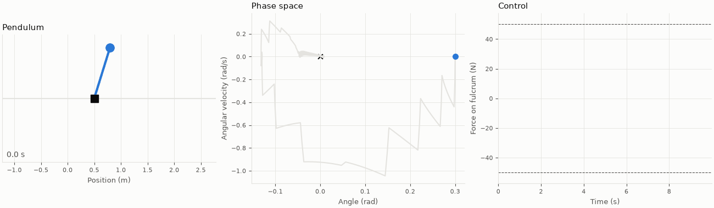
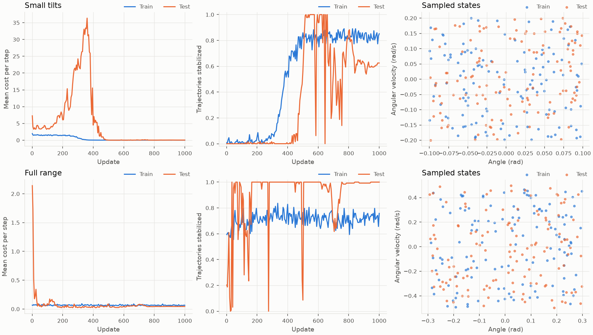

# PendulumControlRL





These plots use one 0.005 s force pulse every 0.55 s. The network trains with force limited to
500 N, and the simulation rounds its force to multiples of 50 N, so small corrections become no
tap at all and the wobble stays visible. These settings are in `scripts/stabilize_pendulum.py`.
The library default is one pulse of up to 50 N every 0.1 s, with no rounding.

A neural network learns to balance an inverted pendulum on a moving fulcrum, using JAX,
Equinox and Diffrax. The network maps the state directly to a force on the fulcrum along x.

The network acts once every 0.1 s, roughly human reaction time. Its force lasts 0.01 s and
the pendulum coasts until the next decision. The integrator step is 0.005 s, 20 times smaller
than the control interval. All units are SI.

State is `[position, angle, velocity, angular velocity]`, with angle 0 upright.

## Setup

```sh
uv sync
git config core.hooksPath .githooks
```

The hook checks Ruff formatting, Ruff linting and Ty types on every commit.

## Experiments

```sh
uv run python scripts/stabilize_pendulum.py         # learn from scratch, with a GIF
uv run python scripts/compare_training_methods.py   # compare methods from scratch
uv run python scripts/pretrain_then_train.py        # pretraining followed by training
uv run python scripts/live_training.py              # learn during one run with no resets
uv run python scripts/pretrain_then_live.py         # batch training, then learn during one run
```

Output is written to `reports/`.

## Assembling an experiment

```python
simulation = PendulumSimulation(fulcrum_mass=1.0, pendulum_mass=0.1, length=1.0)
agent = StateControlAgent(StateControl(key, hidden_size=64), max_force=50.0)
agent, histories = run_training(
    agent, simulation, [PolicyGradientTraining(updates=1500)], key
)
```

Training methods run in sequence and are interchangeable:

| Class | How it learns |
| --- | --- |
| `PolicyGradientTraining` | Weights sampled controls by the reward that follows them |
| `ProximalPolicyTraining` | Policy updates limited near the sampled policy, with a learned value network |
| `SimulationGradientTraining` | Gradient of trajectory cost through the simulation itself |
| `LiveProximalPolicyTraining` | Proximal policy updates during one continuous run, with optional random weight perturbations when cost is high and the gradient is small |
| `OptimalControlPretraining` | Regression onto forces found by optimizing through the simulation |

`SimulationGradientTraining` is unreliable with pulsed control and often fails to stabilize.
`ProximalPolicyTraining` defaults to one optimizer step per batch.
`LiveProximalPolicyTraining` has not stabilized the pendulum from scratch in a single run.
From a network pre-trained with `PolicyGradientTraining`, it lowers cost near upright at first,
but recovery from larger tilts degrades within hours and the pendulum can eventually fall.

To add a method, subclass `TrajectoryTraining` and write `update`, or write any class with
the `train` method of the `TrainingMethod` protocol.
